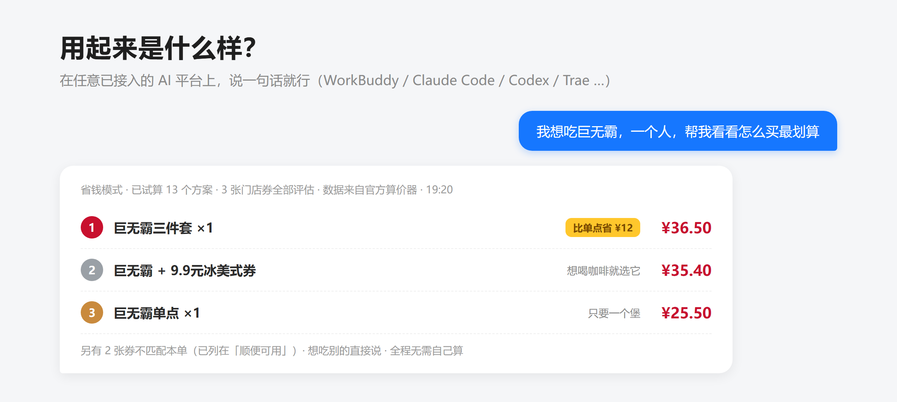
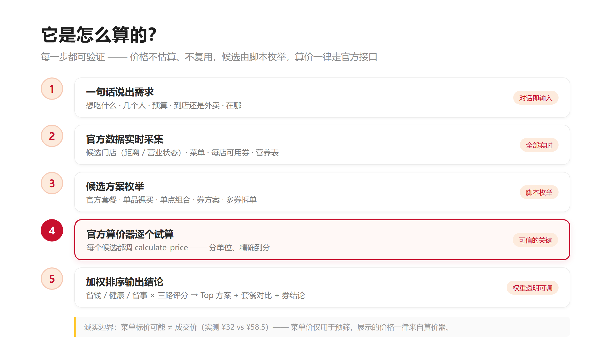
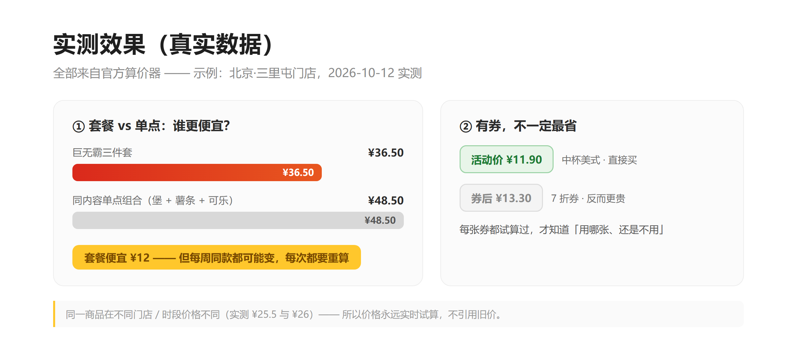

# 麦麦最优方案 · mcd-best-deal

<p align="center">
  
</p>

<p align="center">
  <a href="#目标用户"></a>
  <a href="#实测效果真实数据"></a>
  <a href="#使用"></a>
  <a href="#安装"></a>
  <a href="#工作原理为什么可信"></a>
  <a href="https://github.com/lzitong01-wq/mcd-best-deal/stargazers"></a>
</p>

> 想吃麦当劳的时候，说一句「想吃什么、几个人、什么预算」——它会用麦当劳官方数据，把「怎么买最划算」算给你：**套餐还是单买、每张券怎么用最划算、去哪家店、堂食还是外卖**，价格全部来自官方算价器，逐项可验证。它还会记住你的偏好（忌口、口味、常用位置），越用越顺手。

- 数据来源：麦当劳中国官方 MCP（`mcd-mcp` 连接器，35 个官方工具）
- 运行形态：Agent Skills 标准技能，支持 WorkBuddy / Claude Code / Codex / Trae 等平台（零依赖 Node.js 脚本）
- 关键原则：**候选由脚本枚举，价格由官方试算，AI 只负责理解你、讲清楚、并把关确认**

---

## 目标用户

- **麦门常客**：常吃麦当劳、手里攒着券却总忘记用的人；
- **精打细算党**：纠结「套餐还是单点」，想让每一单都花得明白的人；
- **有娃家庭**：周末带孩子吃，要兼顾预算、距离和餐品选择的人；
- **控卡 / 健身人群**：想在麦当劳里选出相对健康的一餐、需要热量与营养参考的人；
- **赶时间的上班族与学生**：午休只想快速知道「去哪家、买什么、花多少」的人。

## 它解决什么问题

| 你的困惑 | 它的答案 |
| --- | --- |
| 「巨无霸到底是买套餐还是单点？」 | 同一门店、同一时间，套餐与单点组合各算一遍，直接告诉你「套餐省 ¥12」——**买哪种由你选** |
| 「我手里这些券怎么用最划算？」 | **综合评估所有券**：代表性候选（含套餐与单点组合）× 每张门店可用券逐一试算，告诉你用哪张、怎么组合最优；多张券想都用上 → **拆单方案**（分 N 单各用一张） |
| 「哪家店买最便宜/最近？」 | 多门店并行比价，价格与距离一起看 |
| 「今天想吃健康点」 | 健康模式：按热量/蛋白质/脂肪/钠目标区间筛选，标注真实营养数据（数据不完整会如实标注） |
| 「外卖还是自取？」 | 两个场景各自试算（外卖含配送费/打包费），拿实付价比 |
| 「我挑食 / 不吃辣 / 只想要正餐」 | **用户偏好**：首次确认忌口与口味，自动排除不吃的；饮品/冰淇淋默认不计入正餐——想喝想吃了直接点名即可 |
| 「每次都要报一遍位置和口味？」 | 偏好里存好常用位置与默认模式，之后一句话就能开算 |

## 三种模式（每次可选）

| 模式 | 目标 | 默认权重（价格/营养/便利） |
| --- | --- | --- |
| **省钱** | 实付最低 | 0.70 / 0.10 / 0.20 |
| **健康** | 营养目标优先 | 0.20 / 0.60 / 0.20 |
| **省事** | 距离/步骤最少 | 0.25 / 0.15 / 0.60 |

权重与全部细则都在 `config/rules.json`——**你可以直接改文件，或让 AI 按你的话改**。

## 用户偏好（首次确认，随时可改）

首次使用时，它会问 3-4 个小问题并把答案记到 `~/.mcd-best-deal/preferences.json`：

| 偏好 | 作用 |
| --- | --- |
| 忌口 / 不爱吃 | 推荐时自动排除 |
| 口味偏好（如「爱吃辣」） | 匹配的商品在候选中优先 |
| 默认模式 | 不指定时使用（省钱 / 健康 / 省事） |
| 常用位置（城市 + 商圈） | 到店场景免每次报位置 |

随时改动：说「改一下我的偏好」，或直接运行 `node scripts/preferences.mjs set --avoid 香菜 --city 北京`。

## 安装

本技能遵循 **Agent Skills 开放标准**（一个文件夹 + `SKILL.md`），可安装到任何支持该标准的 AI 工具。已适配：

| 平台 | Skills 目录 | MCP 配置位置（可选增强） |
| --- | --- | --- |
| **WorkBuddy** | `~/.workbuddy/skills/` | `~/.workbuddy/mcp.json` |
| **Claude Code** | `~/.claude/skills/` | `~/.claude.json`（或 `claude mcp add`） |
| **Codex** | `~/.agents/skills/`（旧版：`~/.codex/skills/`） | `~/.codex/config.toml` |
| **Trae** | `~/.trae-cn/skills/`（或项目内 `.trae/skills/`） | 设置 → MCP → 手动添加 |
| 其他工具 | 任何支持 `.agents/skills/` 约定的环境 | 按各工具文档配置 |

### 第 1 步 · 安装技能（三选一）

**方式 A：生态 CLI（npx skills）** —— 适用于已接入 [skills 生态](https://skills.sh) 的 40+ 平台（Claude Code / Codex / Cursor 等），本仓库已被该 CLI 正确识别（实测）：

```bash
npx skills add lzitong01-wq/mcd-best-deal           # 交互式：选择技能与目标平台
npx skills add lzitong01-wq/mcd-best-deal -g -y     # 非交互：全局安装到全部已装平台
```

**方式 B：一键安装脚本（推荐，离线可用）** —— 自动检测本机平台并安装：

```bash
# macOS / Linux / Windows Git Bash
bash skill/mcd-best-deal/install.sh

# Windows PowerShell
powershell -ExecutionPolicy Bypass -File skill\mcd-best-deal\install.ps1

# 指定平台 / 预览：--target claude   --dry-run
```

**方式 C：手动安装** —— 把 `skill/mcd-best-deal` 整个文件夹复制到上表对应平台的 Skills 目录。

### 第 2 步 · 配置 Token（首次使用，约 1 分钟，所有平台通用）

1. 到 [open.mcd.cn/mcp/doc](https://open.mcd.cn/mcp/doc) 登录 → 控制台 → 激活 → 一键复制 Token；
2. 运行一次配置脚本（Token 粘贴到提示符，输入不回显）：

```bash
node "<技能目录>/scripts/setup-connector.mjs"
```

脚本会一口气完成：写入**通用凭证文件**（所有平台通用）→ 自动写入检测到的平台 MCP 配置（WorkBuddy / Claude Code / Codex，写前备份）→ 在线验证 → 为 Trae 输出添加指引。全程不打印 Token。

3. 按所在平台完成启用：

| 平台 | 启用方式 |
| --- | --- |
| WorkBuddy | 连接器管理页对 `mcd-mcp` 点「Trust」→ 左下角「+」启用 → 重开会话 |
| Claude Code | 重启会话，`/mcp` 可看到 `mcd-mcp` |
| Codex | 重启后 `codex mcp list` 确认加载 |
| Trae | 按脚本输出的指引在「设置 → MCP」添加后重启 |

> ⚠️ Token 等同账号凭证，只在自己的对话里粘贴，不要发到群聊或公开场合。

### 附：手动配置 MCP 片段（偏好手动/未用脚本时）

<details>
<summary>各平台配置参考（点击展开）</summary>

**Claude Code**（终端命令）：
```bash
claude mcp add --transport http mcd-mcp https://mcp.mcd.cn --header "Authorization: Bearer <Token>"
```

**Codex**（`~/.codex/config.toml`）：
```toml
[mcp_servers.mcd-mcp]
url = "https://mcp.mcd.cn"
http_headers = { Authorization = "Bearer <Token>" }
```

**Trae**（设置 → MCP → 手动添加，粘贴 JSON）：
```json
{ "mcpServers": { "mcd-mcp": { "url": "https://mcp.mcd.cn", "headers": { "Authorization": "Bearer <Token>" } } } }
```

**通用（环境变量方式）**：任何环境下设置 `MCD_MCP_TOKEN=<Token>`，本技能脚本即可直连官方 MCP，**无需平台 MCP 配置**。

</details>

## 使用

<p align="center">
  
</p>

装好后，直接说：

> 「我想吃巨无霸，一个人，帮我看看怎么买最划算」（省钱）
> 「今晚想吃健康点，两个人，预算 80」（健康）
> 「附近有什么能快速吃到的，懒得出门」（省事，外卖）
> 「不知道吃啥，你看着办」（它会先问你想吃什么方向，不瞎猜）

你会得到：**Top 3 方案对比**（实付价 / 优惠明细 / 门店距离 / 推荐理由）+ **套餐 vs 单点结论** + **每张券的试算对比（用哪张最划算）** + **顺便可用的券提示**。

**买法由你定**：结果会按「套餐 / 单点 / 券 / 拆单」分组呈现——想买套餐就看套餐组，想单点就看单点组，想把手里的多张券都用上就看拆单组（明确标注需分几次下单）。选定后，确认明细即可下单（支付在你自己的麦当劳官方流程完成）。

## 命令行（进阶，零依赖，Node 20+）

```bash
# 体检
node scripts/check-connector.mjs

# 采集（到店）
node scripts/collect.mjs --city 北京 --keyword 三里屯 --max-stores 2 --output mcd-data.json

# 计算（省钱模式，想吃巨无霸，1 人）
node scripts/plan.mjs --input mcd-data.json --mode save --people 1 --want 巨无霸 --top 3 --output mcd-plan.json

# 外卖场景：先查地址 → 再采集
node scripts/collect.mjs --scene delivery --address-id <地址ID> --output mcd-data.json

# 用户偏好（查看 / 修改；plan 与 collect 会自动读取）
node scripts/preferences.mjs show
node scripts/preferences.mjs set --avoid 香菜,洋葱 --prefer 麦辣 --mode save --city 北京 --area 国贸
```

## 工作原理（为什么可信）

<p align="center">
  
</p>

- **价格永远来自官方算价器**：不估算、不复用旧价（实测同一商品在不同时段/门店价格不同）。
- **菜单价 ≠ 成交价**：实测发现菜单标价与算价器结果可能不一致（如「巨无霸四件套」菜单 ¥32、算价器 ¥58.5）——因此连菜单价都不直接采用，一切展示价格以官方算价器为准。
- **规则透明**：每个方案的得分由哪几项构成、权重多少，都能在 `config/rules.json` 看到、改到。
- **数据诚实**：营养数据不完整会标注「不计分」；查不到的门店/券会说明，而不是编一个。

## 实测效果（真实数据）

<p align="center">
  
</p>

> 本项目经过两轮外部测试（50 题系统性测试 + 7 项任务实测，发现的缺陷已全部修复并回归）——完整记录见 [TESTING.md](TESTING.md)。

## 已知边界（实测结论）

| 边界 | 说明 |
| --- | --- |
| 一单一券 | 官方限制「暂不支持多张券使用」；技能自动生成**拆单方案**（多张券分多单各用一张，明确标注需分几次下单、分别支付） |
| 券与门店/时段绑定 | 不同门店可用券不同；门店打烊后券列表会消失——每次都要实时查 |
| 门店打烊不可算价 | 可改用预约单（算明天的价格），或换营业中的门店 |
| 营养数据匹配 | 官方营养表与门店商品名不完全一一对应；精确匹配才计分，否则如实标注 |
| 默认只推正餐 | 饮品/咖啡/冰淇淋/甜点默认不进正餐候选（点名即加入）；「人气款」仅作参考，不设硬过滤 |
| 菜单价≠成交价 | 菜单标价可能是展示价/起价/过期活动价——实测存在与算价器不一致的案例；技能只展示算价器结果，菜单价仅用于预筛 |
| 无库存接口 | 官方没有库存查询；「在售」仅能从「菜单在售 + 可算价 + 详情可查」间接判断——查询失败≠商品不存在，也不保证有货 |
| 不自动支付 | 下单后的支付永远在你的官方流程里完成 |

## 项目结构

```text
mcd-best-deal/
├── README.md                     # 项目介绍 / 多平台安装 / 使用示例 / 目标用户
├── CONTEST_DECLARATION.md        # 参赛声明（官方原文）
├── MCP_INTEGRATION.md            # MCP 接入说明（Server / Tool / 流程 / 业务价值）
├── mcp-config.example.json       # MCP 配置示例（脱敏，仅环境变量占位符）
├── workbuddy.md                  # WorkBuddy 开发对话上下文（专项奖励核验用）
├── TESTING.md                    # 测试与质量记录（50 题测试 → 缺陷修复 → 回归）
├── test.sh                       # 自检脚本（结构 / 语法 / 单元测试）
├── tests/                        # 单元测试（node:test，零依赖）
├── LICENSE                       # MIT 开源许可证
├── images/                       # README 配图（banner / 用法 / 原理 / 实测）
└── skill/mcd-best-deal/          # 技能本体（源代码，复制即安装）
    ├── SKILL.md                  # 行为规范（触发描述 / 红线 / 主流程 / 展示规范）
    ├── install.sh · install.ps1  # 一键安装脚本
    ├── config/rules.json         # 可调规则（模式权重 / 营养目标 / 约束）
    ├── references/               # 详细文档（排障手册 / 多平台 / 数据管道）
    └── scripts/                  # 全部运行代码（零依赖）
```

## 开源协议

本项目基于 [MIT License](LICENSE) 开源。

## 免责声明

本项目为个人开发的第三方工具，非麦当劳官方产品。所有价格、券、活动、门店信息均以麦当劳官方实时返回为准。
